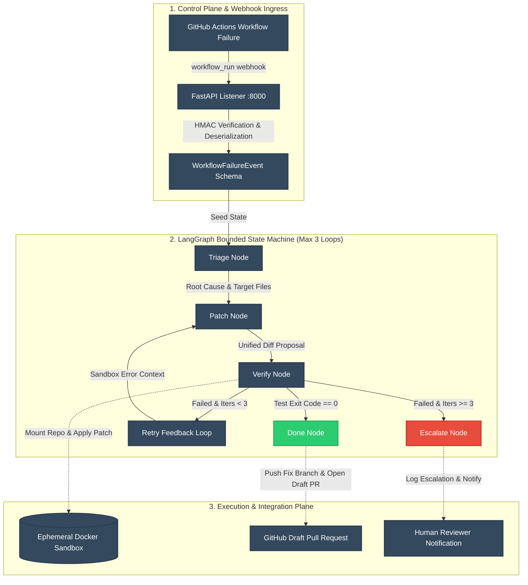
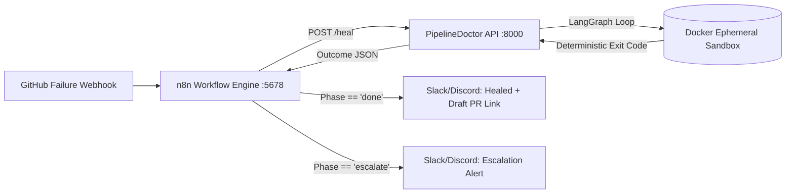

# PipelineDoctor 🩺⚡

> **Autonomous, Event-Driven Self-Healing CI/CD & QA Agent System**  
> *Deterministic verification inside ephemeral sandboxes — zero unverified PRs.*

[](https://github.com/ayoubanlouf/PipelineDoctor/actions/workflows/ci.yml)
[](https://www.python.org/)
[](https://fastapi.tiangolo.com)
[](https://langchain-ai.github.io/langgraph/)
[](https://www.docker.com/)
[](https://n8n.io/)
[](https://opensource.org/licenses/MIT)

---

## 🎯 Executive Overview

CI/CD pipelines break constantly due to **selector drift in E2E tests**, **minor application regressions**, and **flaky test environments**. Traditional AI coding assistants hallucinate or push unverified patches directly into production branches.

**PipelineDoctor** eliminates CI/CD triage fatigue with an autonomous, bounded self-healing agent loop:
1. **Listens** for GitHub Actions `workflow_run` failure webhooks.
2. **Triages** root cause into `selector_drift | app_bug | flaky_env` using local or private LLMs (e.g. `Qwen3.5 9B`).
3. **Generates targeted unified diffs** (`diff -u` patches).
4. **Deterministically verifies** patches inside isolated, ephemeral Docker sandboxes.
5. **Opens Draft PRs** with full diagnostic audit trails **only when sandbox exit code == 0**.
6. **Enforces a strict bounded loop** (max 3 iterations) that automatically escalates to a human engineer if a fix cannot be deterministically verified.

---

## 🏛️ System Architecture



---

## 🛡️ Why the Bounded Verification Loop Matters

| Risk in Unbounded LLM Agents | PipelineDoctor Deterministic Guardrail |
|---|---|
| **Hallucinated Syntactic Fixes** | Unified diffs are physically applied and compiled in an ephemeral container. |
| **Silent Test Suite Regressions** | Patches must pass the full test suite (`exit_code == 0`) before git push. |
| **Runaway Token Costs & Infinite Loops** | Hard bounded state machine caps healing iterations at 3. |
| **Leaked Secrets & Malicious Code** | Containers run with `network_mode="none"`, memory limits, and zero host secret mounts. |
| **Broken Master Branches** | PipelineDoctor opens **Draft PRs** only — never pushes directly to production branches. |

---

## 📊 Verified Benchmark Performance

PipelineDoctor includes an end-to-end simulation and benchmark suite ([`scripts/run_benchmark.py`](scripts/run_benchmark.py)) evaluated strictly against a real local LLM (**`Qwen3.5 9B`** on Bionic at `http://localhost:1235/v1`) and real **Docker containers** (`pipelinedoctor-sandbox:latest`):

```bash
python scripts/run_benchmark.py --verbose
```

### Unedited Live Benchmark Report (`Qwen3.5 9B` + Real Docker Sandboxes)

| Scenario | Archetype | Expected Outcome | Actual Outcome | Iterations | MTTF (Mean Time to Fix) |
|---|---|---|---|---|---|
| **Checkout UI Button** | `selector_drift` | Resolved | `AgentPhase.DONE` | 1 | **67.08s** |
| **Cart Pricing Math** | `app_bug` | Resolved | `AgentPhase.DONE` | 1 | **132.44s** |
| **External Gateway Down** | `flaky_env` | Escalated | `AgentPhase.ESCALATE` | 3 | **184.33s** |

#### Verified Metrics
- **Resolvable Pass@1 Rate:** `100.0%` *(Both UI selector drift and app logic bugs patched and verified on iteration 1)*
- **Resolvable Pass@3 Rate:** `100.0%`
- **Safety Escalation Guard:** `100.0%` *(Zero unverified PRs created for unfixable external infrastructure outages; safely capped at 3 loops)*
- **Average Iterations:** `1.7`
- **Mean Time to Fix (MTTF):** `127.95s`

---

## 🧰 Tech Stack & Component Deep-Dive

| Component | Technology | Rationale |
|---|---|---|
| **Control Plane** | `FastAPI`, `Uvicorn` | Async webhook receiver with HMAC-SHA256 signature verification and background task scheduling. |
| **Orchestration** | `LangGraph` | Strict state-graph transitions enforcing `Triage -> Patch -> Verify -> (Done \| Escalate)`. |
| **LLM Inference** | `OpenAI SDK`, `Qwen3.5 9B` | OpenAI-compatible endpoint with custom `<think>...</think>` tag stripping and fallback JSON extraction. |
| **Execution Sandbox** | `Docker SDK` | Isolated ephemeral containers with `network_mode="none"`, CPU/memory caps, and automatic cleanup. |
| **GitHub Integration** | `PyGithub` | Automated workflow log extraction (ZIP streams), branch creation, and draft PR generation. |
| **Contracts & Config** | `Pydantic v2`, `pydantic-settings` | Frozen, immutable schemas for zero runtime state mutation bugs. |

---

## 🚀 Quick Start & Local Setup

### 1. Prerequisites
- Python 3.11+
- Git
- Docker (Docker Desktop or WSL2 Docker daemon)
- Local LLM server (e.g. Bionic running `Qwen3.5 9B` at `http://localhost:1235/v1`)

### 2. Installation
```bash
# Clone the repository
git clone https://github.com/ayoubanlouf/PipelineDoctor.git
cd PipelineDoctor

# Create and activate virtual environment
python -m venv .venv
.venv\Scripts\activate          # Windows
# source .venv/bin/activate     # macOS/Linux

# Install dependencies in editable mode with development extras
pip install -e ".[dev]"

# Configure environment variables
cp .env.example .env
```

### 3. Run the Test Suite
```bash
# Execute fast, deterministic pytest suite (9 passing tests)
pytest -v
```

### 4. Run the Live Benchmark
```bash
# Run the 3-scenario live benchmark against local Qwen3.5 9B and Docker
python scripts/run_benchmark.py --verbose
```

### 5. Launch the Webhook Control Plane
```bash
# Start FastAPI webhook server on port 8000
uvicorn pipelinedoctor.api.main:app --host 0.0.0.0 --port 8000 --reload
```

---

## ⚡ Optional n8n Orchestration & Alerting Stack

PipelineDoctor provides an optional **Docker Compose stack** and exportable **n8n workflow** (`n8n/pipeline_doctor_workflow.json`) for teams that prefer visual webhook routing and team notifications (Slack/Discord) without touching the core LangGraph verification engine:



### 1. Launch with Docker Compose
```bash
# Build PipelineDoctor and launch n8n alongside it
docker compose up -d
```
- **PipelineDoctor Control Plane:** Available at `http://localhost:8000` (mounts `/var/run/docker.sock` to spawn isolated verification sandboxes and routes to local LLM via `host.docker.internal`).
- **n8n Orchestration Console:** Available at `http://localhost:5678`.

### 2. Import the Ready-to-Use n8n Workflow
1. Open `http://localhost:5678` in your browser.
2. Select **Add workflow** -> **Import from File**.
3. Choose [`n8n/pipeline_doctor_workflow.json`](n8n/pipeline_doctor_workflow.json) (or browse to `/workflows` in the container).
4. Update the placeholder Slack/Discord webhook URLs in the two alert nodes.
5. Set your GitHub repository webhook to deliver `workflow_run` events to:
   ```
   http://<your-server-or-domain>:5678/webhook/github-workflow-failure
   ```

---

## 📂 Project Structure

```
PipelineDoctor/
├── pyproject.toml                     # Modern Hatchling package configuration
├── docker-compose.yml                 # Orchestration stack (PipelineDoctor + n8n)
├── Dockerfile                         # Lightweight container for FastAPI control plane
├── .dockerignore                      # Container build exclusion rules
├── .gitignore                         # Strict repository hygiene rules
├── .env.example                       # Pydantic-settings environment documentation
├── README.md                          # Recruiter-ready technical documentation
├── n8n/
│   └── pipeline_doctor_workflow.json  # Importable n8n visual automation workflow
├── pipelinedoctor/
│   ├── schemas.py                     # Single source of truth for Pydantic v2 contracts
│   ├── config.py                      # Application settings via pydantic-settings
│   ├── api/
│   │   ├── __init__.py
│   │   └── main.py                    # FastAPI webhook listener & /heal control plane
│   ├── agents/
│   │   ├── __init__.py
│   │   ├── llm_client.py              # OpenAI-compat client + <think> stripper & fallback parser
│   │   └── graph.py                   # LangGraph bounded state machine
│   ├── sandbox/
│   │   ├── __init__.py
│   │   └── executor.py                # Ephemeral Docker container executor
│   └── integrations/
│       ├── __init__.py
│       └── github.py                  # PyGithub client (logs, branches, draft PRs)
├── scripts/
│   ├── run_benchmark.py               # E2E simulation and benchmark suite
│   └── test_llm_contract.py           # LLM structured-output smoke test harness
└── tests/
    ├── __init__.py
    └── test_graph_flow.py             # Unit and integration test suite (100% pass)
```

---

## 📜 License

Distributed under the MIT License.
